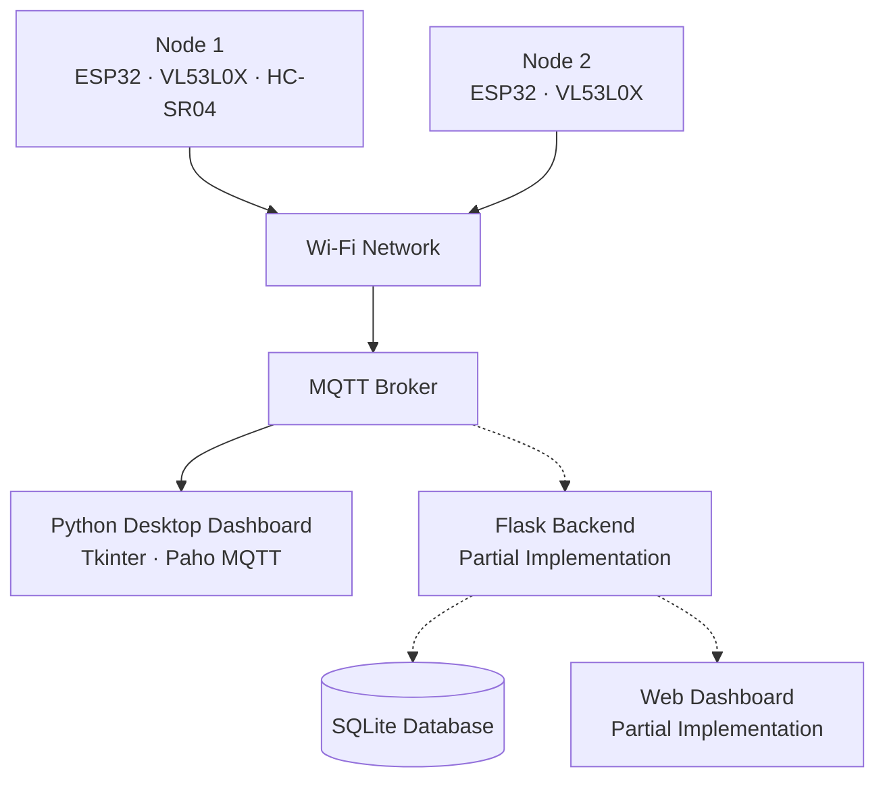

# Real-Time Traffic Monitoring System

An embedded IoT project for vehicle detection and road traffic monitoring, developed as a final-year project at the **Institut Supérieur des Arts Multimédias de la Manouba (ISAMM)**.

## Overview

This project uses two ESP32-based sensor nodes to detect passing vehicles and transmit detection data over Wi-Fi using MQTT. It combines embedded programming, distance sensing, and desktop monitoring, with additional work on traffic data storage and web-based visualization.

## Project Resources

- **Project Report:** [View the report](docs/RAPPORT.pdf)
- **Prototype Demo:** [Watch the demonstration](https://youtu.be/V3mk6v1Oa1w)

## System Architecture

The ESP32 nodes collect distance measurements and transmit vehicle-detection messages over MQTT. The Python desktop dashboard provides a monitoring interface. Flask-based backend and web dashboard components were also explored, but remain partially implemented.

## Hardware

- **ESP32 × 2** — embedded sensor nodes
- **VL53L0X** — time-of-flight distance sensor on both nodes
- **HC-SR04** — ultrasonic sensor on Node 1
- **Solar panel and rechargeable batteries** — explored for outdoor power autonomy

## Technology Stack

| Component | Technologies |
|---|---|
| Embedded firmware | C/C++, Arduino IDE |
| Distance sensing | VL53L0X, HC-SR04 |
| Communication | Wi-Fi, MQTT |
| Desktop monitoring | Python, Tkinter, Paho MQTT |
| Data storage | SQLite |
| Backend and web interface | Flask, HTML, CSS, JavaScript — partial implementation |

## Key Features

- Distance-based vehicle detection using two ESP32 sensor nodes
- MQTT messaging over Wi-Fi
- Vehicle-count and distance monitoring through a Python desktop dashboard
- Database schema for routes, sensor nodes, vehicle detections, and historical records
- Exploration of traffic statistics and web-based visualization

## Project Status

The integrated prototype was demonstrated working. The Flask backend and web dashboard remain partially implemented. Detection accuracy, estimated vehicle speed, and vehicle classification depend on sensor configuration and calibration.

## Academic Context

- **Institution:** Institut Supérieur des Arts Multimédias de la Manouba (ISAMM)
- **Degree:** Licence en Sciences de l’Informatique
- **Specialization:** Micro-Informatique et Machines Embarquées (MIME)
- **Project title:** *Système de Surveillance du Trafic en Temps Réel*
