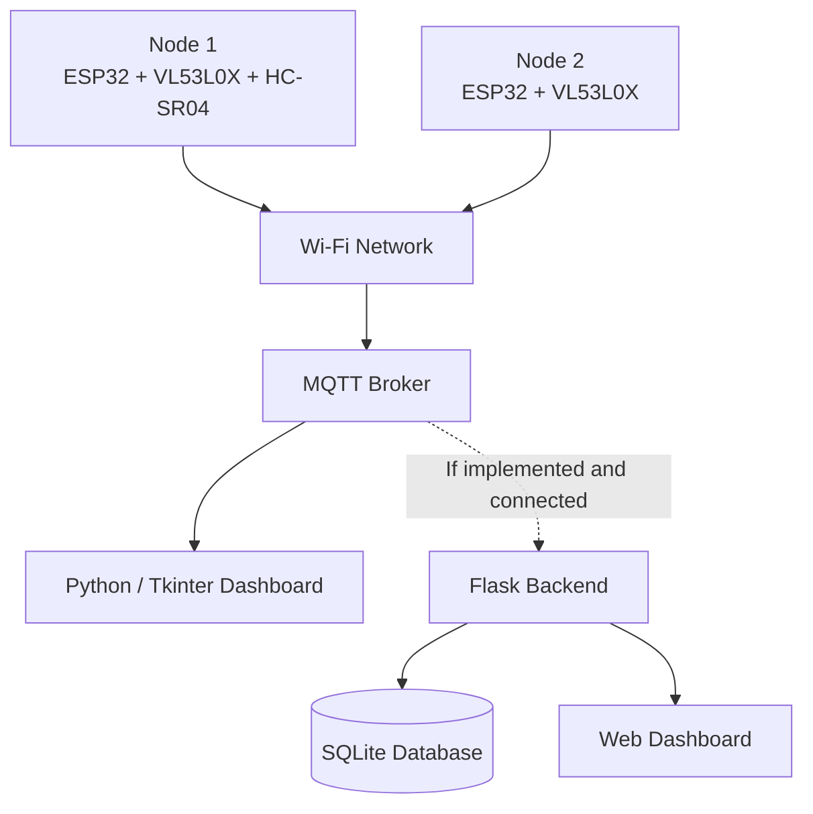

# Real-Time Traffic Monitoring System

An embedded IoT project for vehicle detection and road traffic monitoring, developed as a final-year project at **ISAMM**, Licence en Sciences de l’Informatique — Micro-Informatique et Machines Embarquées (MIME).

## Overview

The system uses two ESP32-based sensor nodes to detect passing vehicles and transmit detection data over Wi-Fi using MQTT. The project also includes a Python desktop dashboard prototype and an SQLite database schema for managing traffic records.

The prototype explores vehicle counting, distance measurement, estimated vehicle speed and classification, with an emphasis on embedded sensing and IoT communication.

## System Architecture



*Note: The diagram represents the reported system design. The connection between the MQTT broker, Flask backend, database, and web dashboard must be confirmed against the final source code.*

## Hardware

- ESP32 microcontrollers — two sensor nodes
- VL53L0X time-of-flight distance sensors
- HC-SR04 ultrasonic sensor on Node 1
- Solar panel and rechargeable battery components for power experiments

## Technologies

| Area | Technologies |
|---|---|
| Embedded development | C/C++, Arduino IDE |
| Distance sensing | VL53L0X, HC-SR04 |
| Communication | Wi-Fi, MQTT |
| Desktop interface | Python, Tkinter, Paho MQTT |
| Data storage | SQLite |
| Backend and web interface | Flask, HTML, CSS, JavaScript — subject to implementation verification |

## Repository Structure

```text
real-time-traffic-monitoring/
├── firmware/
│   ├── node1/
│   └── node2/
├── dashboard/
├── database/
│   └── schema.sql
├── media/
│   ├── prototype/
│   ├── sensors/
│   └── dashboard/
├── docs/
└── README.md
```

The folders should reflect the files actually included in the repository.

## Main Components

- **Sensor nodes:** Read distance measurements and implement vehicle-detection logic.
- **MQTT communication:** Provides a messaging mechanism for transmitting sensor data.
- **Desktop dashboard:** A Python interface designed to display vehicle counts and distance readings received over MQTT.
- **Database schema:** Defines tables for routes, sensor nodes, vehicle detections and historical records.

## Project Status

This repository documents the available firmware, dashboard code, database schema and hardware prototype. MQTT topic and message-format consistency, vehicle speed estimation, and end-to-end integration should be validated against the final versions before all features are considered fully operational.

## Documentation and Media

The `docs/` directory can contain the project report and presentation. The `media/` directory can contain original prototype photographs, sensor setups and screenshots of the available interfaces.

## Academic Context

**Institution:** Institut Supérieur des Arts Multimédias de la Manouba (ISAMM)  
**Degree:** Licence en Sciences de l’Informatique  
**Specialization:** Micro-Informatique et Machines Embarquées (MIME)  
**Project:** Système de Surveillance du Trafic en Temps Réel
